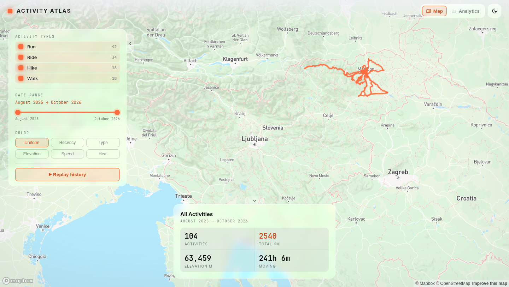
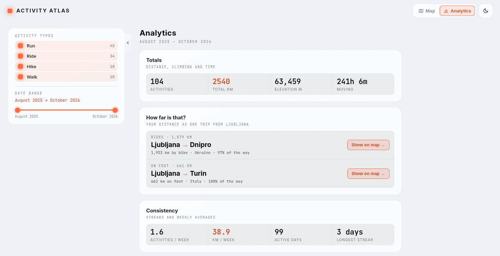

# Activity Atlas

**[Live site →](https://activity-atlas.jakas.si/)**

All your Strava and Garmin activities as routes on one map, with an analytics
page and a local MCP server for asking an LLM about them. Fork it and it runs
on built-in demo data until you import your own.

<p>
  
  
</p>

- **Map:** every route, filtered by type and date, colored by recency, type,
  elevation, speed or heat, and a replay of your history.
- **Activity view:** elevation, heart-rate and pace charts, with a marker that
  follows them along the route.
- **Places:** pick a place to see every activity that went there, and the
  other times on the same route.
- **Analytics:** totals, consistency, an activity calendar with your daily
  steps, the hours of the day you're out, climbing by month, overlaid
  elevation profiles, and your distance as a trip to a city.
- **Data:** Strava and Garmin bulk exports, merged where both recorded the same
  outing, kept current by a daily fetch from Garmin's Personal API.
- **Hosting:** a static site on GitHub Pages. Your data lives in a private R2
  bucket, never in git.

## How it works

```
Strava export ─┐
Garmin export ─┼─▶ archive ─▶ activities.sqlite ─▶ build-tracks.ts ─▶ app/public/data/ ─▶ GitHub Pages
Garmin API ────┘   (raw files)  (activities, streams,                  (static JSON)
  (daily)                        wellness)
```

1. **Import.** The importers and the Garmin fetch store every source file
   byte for byte in the archive, then parse it into a SQLite database. The
   database can always be rebuilt from the archive.
2. **Merge.** A Strava and a Garmin record of the same outing become one
   activity. Strava's values win; Garmin fills the gaps.
3. **Build.** `build-tracks.ts` turns the database into small JSON files: route
   polylines, each activity's numbers, per-activity samples (loaded when an
   activity is opened), elevation profiles and daily step totals. No other
   wellness data is published.
4. **Deploy.** `deploy.yml` pulls the database from R2 with a read-only token,
   builds the site and publishes it. The browser never calls Strava or Garmin.

Without R2 the archive is `data/archive/` and the database is
`data/activities.sqlite`; a fresh fork builds from the committed demo database
(`data/demo/activities.sqlite`). Everything under `data/` except the demo is
gitignored. Details: [docs/data-pipeline.md](docs/data-pipeline.md).

## Setup

You need Node 22+, pnpm 10 and, for importing, Python 3.12+.

### 1. Run the demo

Fork the repository, so you can pull in upstream changes later:

```bash
gh repo fork <owner>/activity-atlas --clone
cd activity-atlas
pnpm install
cp .example.env .env     # set VITE_MAPBOX_TOKEN, see below
pnpm run dev
```

For the map, create a **public** token at
<https://account.mapbox.com/access-tokens/> (the free tier is enough) and set
`VITE_MAPBOX_TOKEN` in `.env`. Restrict it by URL to the domain you serve the
site from. Without a token the panels and Analytics still work, but the map
area only shows a note.

### 2. Import your data

```bash
python3 -m venv .venv
.venv/bin/pip install -r requirements.txt
export PYTHON_BIN=.venv/bin/python    # the pnpm scripts run $PYTHON_BIN, else python3
```

Download your bulk export from Strava (Settings → My Account → Download or
Delete Your Account → Download Request) and/or Garmin Connect (Account
Settings → Export Your Data), then import the zips, Strava first:

```bash
pnpm run import:strava <strava-export.zip>
pnpm run import:garmin <garmin-export.zip>
pnpm run dev
```

This writes `data/archive/` and `data/activities.sqlite`, which from now on
take precedence over the demo. Importing the same export again adds nothing.
Keep `PYTHON_BIN` set (shell profile or [direnv](https://direnv.net/)), or the
scripts run a Python without the dependencies.

### 3. Deploy to GitHub Pages

1. Settings → Pages → Source = **GitHub Actions**.
2. `gh secret set VITE_MAPBOX_TOKEN` and paste the token at the prompt.
3. Actions → **Deploy** → Run workflow. Without R2 secrets it publishes the
   demo data.

The site is served at `https://<user>.github.io/<repo>/`, or at a custom domain
set under Settings → Pages (a CNAME record to `<user>.github.io`, with
**Enforce HTTPS**). The build takes the base path from the Pages settings.

### 4. Publish your own data

The database is never committed, so the deploy reads it from a private
Cloudflare R2 bucket, and a daily Garmin fetch can keep it current. Both are
set up in [docs/publishing.md](docs/publishing.md).

## Ask an LLM about your data

`ingest/mcp_server` is a local, read-only [MCP](https://modelcontextprotocol.io)
server over `data/activities.sqlite`, for questions like "is my running pace
improving year over year?". Register it with any MCP client that can start a
stdio server, for example in Claude Code (`<checkout>` is your clone's absolute
path):

```bash
claude mcp add --scope user activity-atlas \
  -e PYTHONPATH=<checkout> \
  -- <checkout>/.venv/bin/python -m ingest.mcp_server --db <checkout>/data/activities.sqlite
```

With R2 configured it keeps the local database in sync using the read-only
token; add `--no-sync` to skip that. Only the conversation and any place names
you search for (sent to OpenStreetMap's Nominatim) leave your machine. Its
tools and definitions are described in `ingest/mcp_server/guide.md`.

## Making it yours

- All `pnpm run` scripts are in `package.json`; `pnpm run test:all` runs the
  tests. Environment variables are listed in `.example.env`.
- The home city for the "how far is that?" distances is `ORIGIN` in
  `scripts/build-city-distances.ts`; the initial map view and base map styles
  are `SLOVENIA_CENTER` and `STYLE_URL` in `app/src/MapView.tsx`.
- [CONTEXT.md](CONTEXT.md) is a glossary of the domain terms, and
  [data/demo/README.md](data/demo/README.md) explains the demo data.
